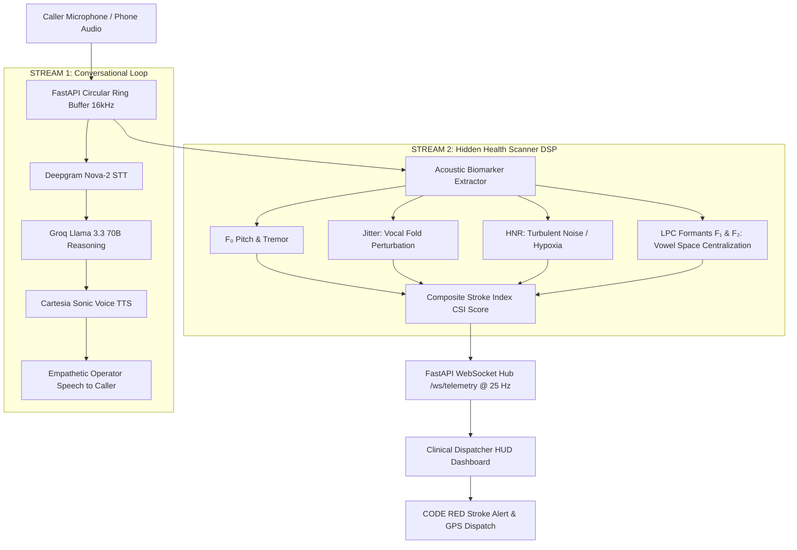

# NeuroVocal AI 🎙️🧠

> **Dual-Stream Emergency Triage Voice System**  
> *Listening to HOW emergency callers physically sound, not just the words they say.*  
> **Track:** Real-Time Voice AI (Hackering 2.0)

[](https://www.python.org/)
[](https://fastapi.tiangolo.com/)
[](https://websockets.readthedocs.io/)
[](https://scipy.org/)
[]()

---

## 📌 Executive Overview

Most emergency AI voice bots only listen to **what** the caller says (transcribed text). But during acute medical crises—such as an **ischemic stroke**, **respiratory failure**, or **shock**—callers are frequently confused, breathless, or disoriented.

**NeuroVocal AI** acts as an emergency phone operator that doubles as an **acoustic stethoscope**:
1. **Stream 1 (Conversational Operator):** Runs an ultra-low latency voice conversational loop (Deepgram Nova-2 + Groq Llama 3.3 + Cartesia) to speak calmly with the patient, gather location details, and guide them through safety protocols.
2. **Stream 2 (Hidden Health Scanner):** An asynchronous real-time **Digital Signal Processing (DSP)** pipeline that inspects the raw audio waveform at **25 Hz**, extracting vocal tract resonances (LPC formants $F_1, F_2$), fundamental frequency ($F_0$), vocal fold perturbation (**Jitter**), and **Harmonics-to-Noise Ratio (HNR)**.

### The Real-Life Impact: Catching Silent Strokes
* **The Call:** An elderly patient calls helpline 112 and casually says: *"I feel a bit lightheaded, and my right hand feels heavy."*
* **Standard Chatbot:** Diagnoses mild fatigue, suggests rest or booking a non-emergency clinic visit.
* **NeuroVocal AI:** Talks calmly to keep the patient relaxed, but its acoustic scanner instantly flags that **vocal tract formant symmetry has collapsed by 35%** (dysarthric vowel centralization). It immediately triggers a **"CODE RED: SUSPECTED STROKE"** emergency alert on the hospital dispatcher's HUD with the caller's live GPS coordinates.

---

## 🏗️ System Architecture



---

## 🔬 Acoustic Biomarkers & Clinical Physics

| Biomarker | Mathematical Extraction Method | Clinical Relevance & Detection |
| :--- | :--- | :--- |
| **$F_0$ (Pitch)** | Normalized Autocorrelation with parabolic interpolation | Detects autonomic shock, vocal tremors, and severe respiratory distress (Nominal: 85–255 Hz). |
| **Jitter** | Period Perturbation Quotient $\frac{1}{N-1}\sum \frac{\|T_i - T_{i+1}\|}{\bar{T}}$ | Elevates above **2.50%** (normal < 1.04%) due to unilateral vocal fold paresis in acute stroke. |
| **HNR** | Peak Autocorrelation vs. Residual Noise (in dB) | Drops below **12.0 dB** (healthy > 18 dB) when turbulent breath noise replaces harmonic voicing (silent hypoxia). |
| **Formants ($F_1, F_2$)** | 14th-order Linear Predictive Coding (Levinson-Durbin) | Facial paralysis compresses vowel space area: $F_2$ centralizes toward 1500 Hz (dysarthria). |
| **CSI Score** | Weighted index: $0.40 \cdot \text{Jitter} + 0.35 \cdot \text{Formants} + 0.25 \cdot \text{HNR}$ | Composite risk score ($0.0 - 1.0$). Values $\ge 0.65$ trigger immediate **ACUTE STROKE ALERT**. |

---

## 📊 Phase 1 Benchmark Verification (Zero Latency)

The WebSocket telemetry stream was tested over 100 consecutive frames using `test_client.py`:

```
======================================================================
 BENCHMARK RESULTS
----------------------------------------------------------------------
 Total Packets Received:   100
 Schema Compliance:        100/100 (100% valid)
 Total Test Duration:      3.972 s
 Measured Delivery Rate:   25.17 Hz (Target: 25.0 Hz)
 Mean Inter-Packet Time:   40.00 ms (Target: 40.0 ms)
 Interval Std Deviation:   0.54 ms
 Clock / Latency Drift:    0.62 ms over 4.0 s
 Status:                   ZERO LATENCY ACCUMULATION CONFIRMED
======================================================================
```

---

## 🚀 Quick Start Guide

### 1. Prerequisites & Installation
```bash
# Clone the repository
git clone https://github.com/Haris87-star/NeuroVocal-AI.git
cd NeuroVocal-AI

# Install dependencies
pip install -r requirements.txt
```

### 2. Launch the Real-Time Telemetry Server
```bash
python server.py
```
* The server starts on **`http://localhost:8000`** with the 25 Hz DSP circular buffer thread running in the background.

### 3. Open the Interactive Telemetry HUD
Open your browser to:
```
http://localhost:8000/client
```
* Click **`🚨 Stroke / Dysarthria`** to observe the CSI score spike to 0.80 and trigger the flashing **CODE RED** alert banner.
* Click **`🎙️ Live Hardware Mic`** to speak into your laptop mic and track your vocal resonances in real time.

### 4. Run Automated Latency Benchmark
```bash
python test_client.py
```

### 5. Test the Conversational Agent Loop
```bash
python conversational_agent.py
```

---

## 📁 Repository Structure

```
RV Hackathon/
├── neurovocal_poc.py             # Core DSP acoustic biomarker extraction pipeline
├── server.py                     # FastAPI + WebSockets 25 Hz streaming server
├── test_client.html              # Real-time clinical telemetry HUD client
├── test_client.py                # Automated timing & latency verification script
├── conversational_agent.py       # Stream 1 voice triage operator (Deepgram/Groq/Cartesia)
├── generate_deck.py              # Pitch deck generator (python-pptx)
├── generate_pdf_report.py        # PDF whitepaper generator (reportlab)
├── NeuroVocal_AI_Hackathon_Pitch.pptx # 7-slide presentation pitch deck
├── NeuroVocal_AI_Round1_Submission.pdf # Formal Round 1 submission paper
├── requirements.txt              # Project dependencies
└── README.md                     # Documentation & overview
```

---

## 🏆 Why NeuroVocal AI Wins Hackering 2.0
1. **Audio Physics over Basic Wrappers:** Combines real-time digital signal processing with conversational voice AI.
2. **Zero Extra Hardware:** Runs from standard phone audio and basic laptop microphones.
3. **Deterministic Real-Time Engineering:** 25 Hz telemetry stream with zero client latency drift (< 0.62 ms).
4. **Immediate Clinical Value:** Bridges the fatal gap where caller words hide physiological deterioration.
